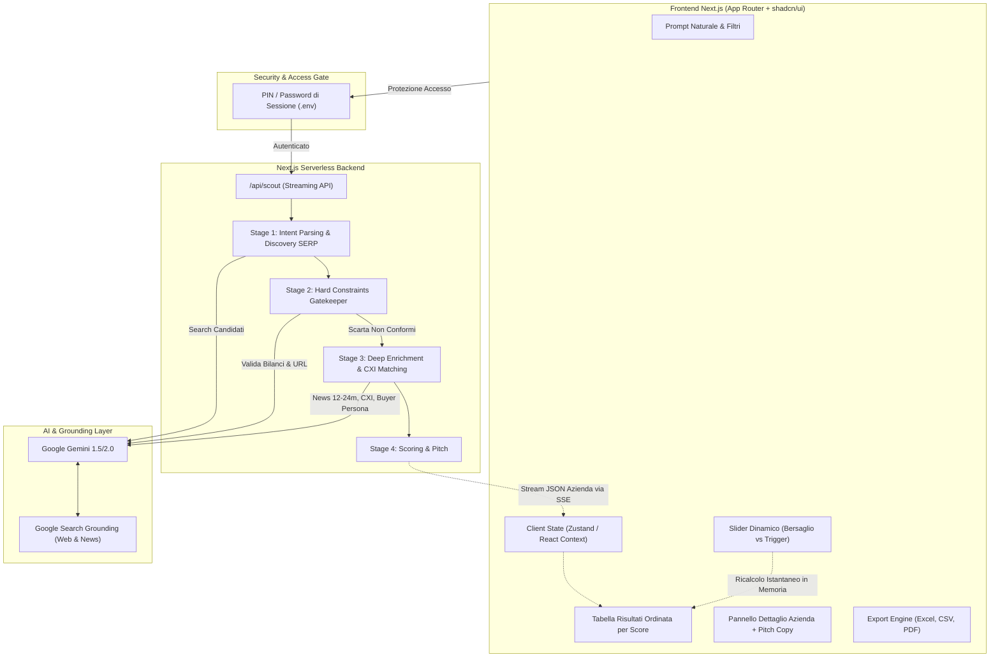
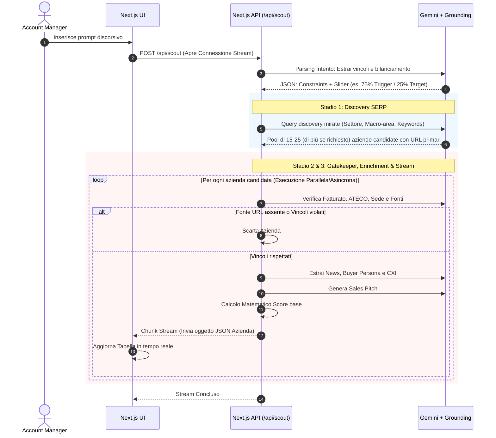

# Software Architecture Document (SAD)
## AI Agent B2B Scouting & CXI Sales Matcher

---

### 1. Vision & Obiettivi del Sistema

L'applicazione è una piattaforma web in **Next.js** progettata per supportare l'Account Manager e il Sales Strategist nell'attività di **Data Research, Scouting B2B e Qualificazione Commerciale**.

A differenza dei tradizionali motori di lead generation o semplici interfacce verso database statici, il sistema:
1. **Interpreta query complesse in linguaggio naturale** estraendo vincoli rigidi (*Hard Constraints*) e intenzione commerciale.
2. **Opera in tempo reale sul Web** sfruttando **Google Gemini con Search Grounding nativo** per scoprire aziende, verificare bilanci/metriche ed estrarre notizie recenti (12-24 mesi).
3. **Applica una Matrice Deterministica di Business (CXI Packages)** che associa gli eventi reali aziendali (trigger) a specifiche soluzioni d'offerta (*Consulting, Digital, Operations, ESG*).
4. **Calcola uno Score Dinamico (1-10)** combinando matematicamente *Aderenza al Bersaglio Ideale* e *Potenza del Trigger*, regolabile tramite uno **Slider interattivo** lato client con ricalcolo e riordinamento istantaneo.
5. **Applica politiche rigorose di Anti-Allucinazione**: scarto immediato delle aziende prive di fonti verificabili (URL pubblici), divieto assoluto di deduzione numerica e malus punitivo (-3 pt) per assenza di Buyer Persona identificata.
6. **Prepara l'aggancio commerciale**: genera una bozza di outreach personalizzata (*Sales Pitch / Icebreaker*) pronta all'uso per l'interlocutore target.

---

### 2. Architettura di Sistema ad Alto Livello (Stateless & Streaming)

L'architettura è rigorosamente **Stateless e In-Memory (No Database)**. I dati processati nei 3 stadi vengono trasmessi al frontend via Server-Sent Events (SSE) o Vercel AI SDK Stream. Lo stato viene mantenuto nel client (tramite React State o Zustand) fino all'esportazione o al ricaricamento della pagina.



---

### 3. Pipeline a 3 Stadi (Dettaglio Tecnico)

L'esecuzione del workflow è gestita interamente dalla rotta API di Next.js che sfrutta lo streaming per eludere i limiti di timeout serverless e fornire feedback in tempo reale all'utente.



#### Stadio 1: Intent Parsing & Discovery
1. **Analisi Semantica del Prompt**: Gemini analizza il testo per estrarre:
   - **Codice ATECO / Settore**: es. Manifatturiero, ICT, Chimico.
   - **Range Fatturato**: Minimo e Massimo (es. `20.000.000€ - 50.000.000€`).
   - **Dipendenti**: Minimo e Massimo.
   - **Geografia**: Macro-area (Nord/Centro/Sud) mappata su regioni e province.
   - **Ponderazione Intento (Auto-Slider)**: Focus Trigger, Focus Bersaglio o Bilanciato.
2. **Generazione Query Discovery**: Generazione pool di **15-25 (di più se richiesto) ragioni sociali candidate**.

#### Stadio 2: Hard Constraints Gatekeeper (Anti-Allucinazione)
Per ogni candidata:
- **Verifica Fatturato e Dipendenti**: Estrazione del valore reale con anno.
- **Regola di Scarto Assoluto per Assenza Fonti**: Se non è reperibile un URL pubblico certificabile, l'azienda viene **scartata a monte**.
- **Divieto di Deduzione**: Se il dato esatto non è noto, l'agente scrive `"N.D."`.

#### Stadio 3: Deep Enrichment, Matching & Streaming
Sulle aziende qualificate:
1. **Scansione News (12-24 mesi)**: Mappatura rigida su CXI.
2. **Identificazione Buyer Persona**: Ricerca di Nome, Cognome e Ruolo esatto. Se non rintracciabile: `"N.D."`.
3. **Scoring e Pitch**: Calcolo dei punteggi parziali e bozza di aggancio.
4. **Trasmissione (Streaming)**: Il backend non aspetta la fine di tutte le aziende. Appena un'azienda è processata, il JSON viene "streammato" al frontend che lo inserisce subito in tabella.

---

### 4. Matrice Deterministica di Business: News $\rightarrow$ Pacchetto CXI

| Pacchetto CXI | Eventi Scatenanti (Trigger 12-24 mesi) | Ruoli Target Buyer Persona Primari |
| :--- | :--- | :--- |
| **Consulting** | Acquisizioni (M&A), fusioni, riorganizzazioni aziendali, apertura nuove filiali all'estero, espansione commerciale. | Chief Executive Officer (CEO), Managing Director, Direttore Strategia, Head of M&A. |
| **Digital** | Attacchi informatici / Data breach, migrazione o adozione ERP/CRM, lancio e-commerce B2B, digitalizzazione processi. | Chief Information Officer (CIO), Chief Technology Officer (CTO), CISO, IT Director. |
| **Operations** | Apertura nuovi stabilimenti o magazzini, colli di bottiglia o crisi di supply chain, ottimizzazione della logistica, automazione industriale. | Chief Operating Officer (COO), Plant Manager, Supply Chain Director, Direttore Logistica. |
| **ESG** | Pubblicazione bilancio di sostenibilità, conseguimento certificazioni ambientali (ISO 14001, ISO 50001), welfare aziendale, transizione energetica. | Chief Sustainability Officer (CSO), ESG Manager, HSE Director, HR Director. |

---

### 5. Motore Matematico di Scoring & Slider Dinamico

#### 5.1 Le Componenti del Punteggio
1. **$S_{\text{target}}$ (Aderenza al Bersaglio Ideale, 1 - 10)**: Geografica, dimensionale e settoriale.
2. **$S_{\text{trigger}}$ (Potenza del Trigger, 0 - 10)**: Gravità dell'evento e decadimento temporale.
3. **$M$ (Malus Strutturale)**: Assenza di Buyer Persona identificata ($M = 3.0$).

#### 5.2 Formula di Calcolo Ponderata
Dati i pesi normalizzati dello Slider:
- $W_{\text{trigger}} \in [0.0, 1.0]$
- $W_{\text{target}} = 1.0 - W_{\text{trigger}}$.

$$S_{\text{raw}} = (W_{\text{target}} \cdot S_{\text{target}}) + (W_{\text{trigger}} \cdot S_{\text{trigger}}) - M_{\text{persona}}$$
$$\text{Score} = \max\left(1.0, \, \min\left(10.0, \, \text{round}(S_{\text{raw}}, 1)\right)\right)$$

#### 5.3 Slider Interattivo Real-Time nel Frontend
L'utente sposta lo Slider nella barra superiore. Il client React (che ha in memoria i dati $S_{\text{target}}$ e $S_{\text{trigger}}$ di ogni azienda) ricalcola all'istante lo score finale e riordina la tabella senza effettuare alcuna nuova chiamata al server.

---

### 6. Modello Dati Stateless (Interfacce TypeScript & JSON Contract)

Poiché non c'è un database, il contratto tra Gemini, il Backend e il Frontend è definito da queste rigide interfacce TypeScript. Ogni azienda trasmessa nello stream deve rispettare il tipo `CompanyResult`.

```typescript
type CXIPackage = "CONSULTING" | "DIGITAL" | "OPERATIONS" | "ESG" | "NONE";

interface Source {
  title: string;
  url: string;
  sourceType: "FINANCIAL" | "NEWS" | "LINKEDIN" | "INSTITUTIONAL";
}

interface CompanyResult {
  // Dati Identificativi
  ragioneSociale: string;
  sedeCitta: string;
  sedeRegione: string;
  atecoCodice: string | "N.D.";
  
  // Metriche Target
  fatturatoValore: number | null;
  fatturatoAnno: number | null;
  dipendenti: number | null;
  
  // Matching CXI & Trigger
  cxiPackage: CXIPackage;
  triggerSummary: string;
  triggerDate: string | null; // ISO Date
  
  // Buyer Persona
  buyerNome: string | "N.D.";
  buyerCognome: string | "N.D.";
  buyerRuolo: string | "N.D.";
  buyerLinkedinUrl: string | null;

  // Valutazioni Numeriche (Calcolate dal Backend, non fittizie)
  scoreTarget: number;
  scoreTrigger: number;
  malusApplied: number;
  scoreFinal: number;
  explainability: string;

  // Commerciale
  salesPitchText: string;
  
  // Fonti Grounding (Obbligatorie)
  sources: Source[];
}
```

---

### 7. Specifiche Tecniche del Frontend (Next.js & UI/UX)

#### 7.1 Layout Tabellare Richiesto
| Colonna | Tipo Visualizzazione | Descrizione & Comportamento |
| :--- | :--- | :--- |
| **Priorità** | Badge Colorato + Ranking | Punteggio da `1.0` a `10.0` (es. Verde per $\ge 8.0$, Giallo per $6.0-7.9$, Grigio per $< 6.0$). Mostra anche il badge rosso `Dato Incompleto` se applicato malus. |
| **Nome Azienda** | Testo Bold + Link Cliccabile | Ragione sociale. Cliccando sulla riga si apre il Drawer laterale di dettaglio. |
| **Sede** | Testo con Icona Pin | Comune e Provincia. |
| **Metriche Target** | 2 Righe compatte | Riga 1: Fatturato. Riga 2: Dipendenti. |
| **Buyer Persona** | Avatar + Testo + Icona | Nome e Ruolo. Se assente: `"N.D."`. |
| **Evento Recente (Trigger)** | Badge Data + Testo Snippet | Data notizia e sintesi dell'evento. |
| **Soluzione CXI** | Tag tematico colorato | Uno dei 4 pacchetti (*Consulting*, *Digital*, *Operations*, *ESG*). |
| **Fonti** | Icone Link Esterni | Icona link con numero di fonti verificate. |

#### 7.2 Pannello di Dettaglio Laterale (Slide-over Drawer)
All'apertura della singola azienda, il pannello presenta:
1. **Header**: Ragione Sociale, Score con badge e barra di progressione.
2. **Box Trasparenza Score**: Formula visiva e spiegazione.
3. **Box Sales Pitch**: Bozza di email con tasto **"Copia Bozza"**.
4. **Dati di Bilancio Certificati** e **Fonti Verificate**.

#### 7.3 Motore di Esportazione
L'esportazione usa i dati presenti nel React State del browser:
- **Export Excel (`.xlsx`)**: Generato lato client tramite `xlsx`.
- **Export CSV**: Esportazione RFC-4180 standard.

---

### 8. Gestione della Sicurezza e Controllo Accessi

1. **Middleware di Protezione Next.js (`middleware.ts`)**:
   - Tutte le rotte intercettate (tranne `/login`).
   - Verifica la presenza del cookie sicuro `scout_session_token`.
2. **Variabile d'Ambiente Protetta (`.env.local`)**: `ACCESS_GATE_SECRET="SalesPass2026!X"`
3. **Flusso**: Login con PIN, validazione in tempo costante, emissione cookie.

---

### 9. Struttura del Progetto Next.js (App Router)

```
b2b-scouting-agent/
├── .env.local
├── middleware.ts                   # PIN/Password Access Gate
├── src/
│   ├── app/
│   │   ├── (auth)/
│   │   │   └── login/page.tsx      # Pagina PIN/Password Gate
│   │   ├── (dashboard)/
│   │   │   ├── layout.tsx          # Topbar con slider e controlli export
│   │   │   └── page.tsx            # Dashboard principale
│   │   └── api/
│   │       ├── auth/session/route.ts
│   │       └── scout/
│   │           └── route.ts        # Streaming API (SSE / Vercel AI SDK)
│   ├── components/
│   │   ├── ui/                     # Componenti shadcn/ui
│   │   ├── scout/
│   │   │   ├── PromptInput.tsx     # Barra di ricerca
│   │   │   ├── DynamicSlider.tsx   # Slider Bersaglio vs Trigger
│   │   │   ├── ScoutTable.tsx      # Tabella React State
│   │   │   ├── CompanyDrawer.tsx   # Drawer laterale
│   │   │   └── ExportDropdown.tsx  # Download XLSX / CSV
│   ├── lib/
│   │   ├── gemini.ts               # Client AI e chiamate Grounding
│   │   ├── scoring.ts              # Motore matematico e explainability
│   │   ├── cxiMatrix.ts            # Tassonomia CXI
│   │   └── export/
│   │       ├── excel.ts            # Client-side Excel generator
│   │       └── csv.ts              # Client-side CSV formatter
```

---

### 10. Strategia Anti-Allucinazione & Fact-Checking

1. **Search Grounding Obbligatorio**: Ogni estrazione di dato economico o notizia aziendale deve essere accompagnata dal relativo URL di origine.
2. **Nessuna Interpolazione di Bilancio**: È vietato chiedere all'LLM di stimare il fatturato.
3. **Penalità Selettiva (Malus vs Scarto)**:
   - **Mancanza Fonti / Valori Finanziari Non Verificabili**: Scarto Totale.
   - **Mancanza Buyer Persona**: L'azienda viene mantenuta, ma subisce un **Malus di -3.0 punti**.

---

### 11. Piano di Rilascio e Prossimi Passi

1. **Fase 1 (Foundations UI)**: Setup repository Next.js 15, autenticazione tramite Session PIN e impalcatura del frontend (shadcn/ui e state management client-side).
2. **Fase 2 (Agent Core & Streaming)**: Implementazione in `api/scout/route.ts` del motore Gemini con Search Grounding e setup del canale Server-Sent Events (SSE) per la trasmissione in tempo reale dei dati al frontend.
3. **Fase 3 (Client Slider & Refining UI)**: Aggancio della tabella allo stream dati e sviluppo della logica matematica client-side per il riordinamento real-time guidato dallo Slider.
4. **Fase 4 (Export & Polish)**: Integrazione degli esportatori Excel/CSV client-side e allineamento design pixel-perfect.